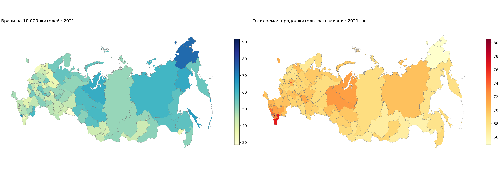
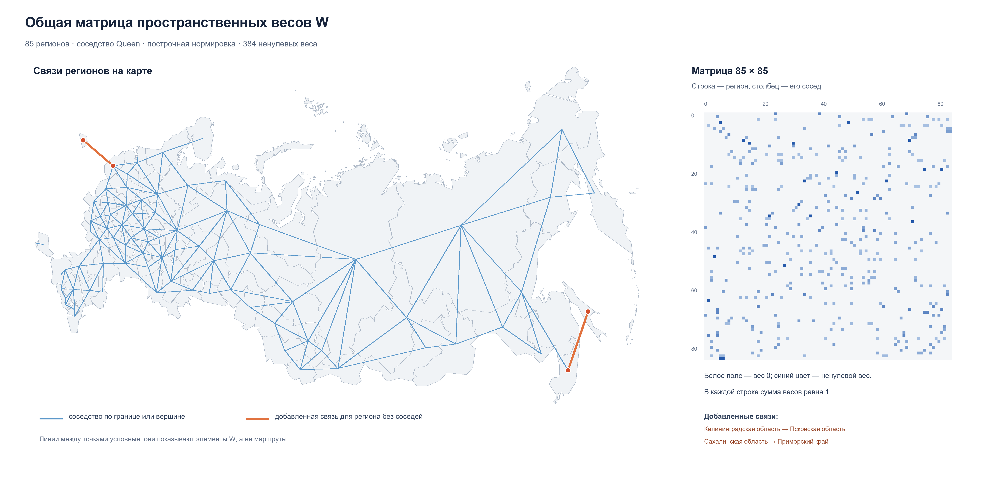
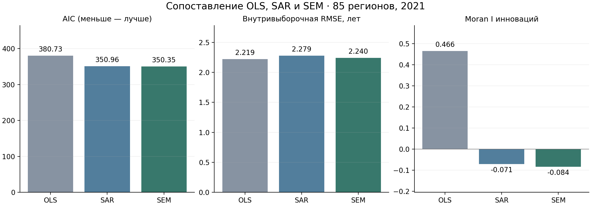
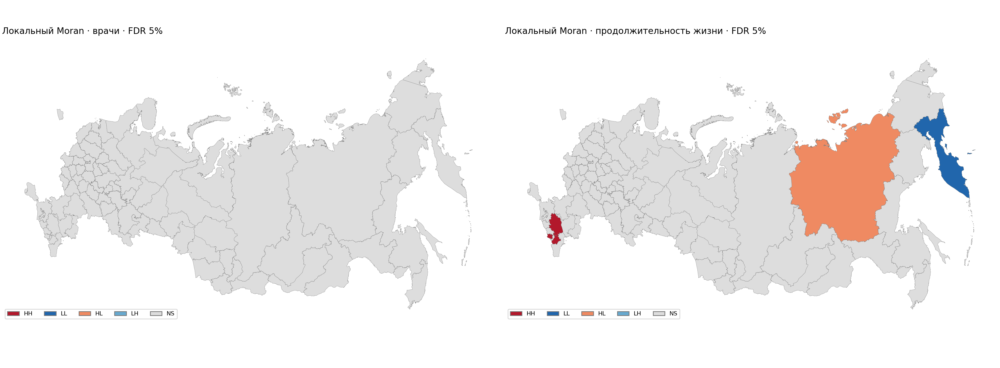
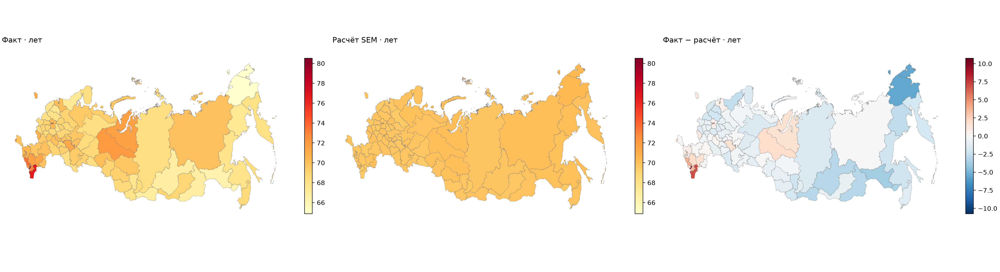
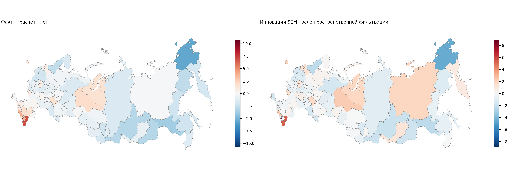

# Здравоохранение и продолжительность жизни: пространственный анализ, 2021

Практические занятия № 11–12 · команда № 1 · магистратура «Искусственный интеллект и анализ данных».

## Команда

| Участник | Вклад |
|---|---|
| [Давидович Владислав (@I-am-a-cup)](https://github.com/I-am-a-cup) | Капитан; интеграция, контроль согласованности, GitHub, подготовка защиты |
| [Протасова Мария (@wlwwwlw)](https://github.com/wlwwwlw) | Данные, пространственная привязка, проверки качества |
| [Павлов Владимир (@KAVABANGAMAN)](https://github.com/KAVABANGAMAN) | Описательная статистика, OLS, SAR, пространственные эффекты |
| [Юсов Илья (@YusovID)](https://github.com/YusovID) | Общая W, SEM, сопоставление моделей, диагностика, устойчивость, итоговые карты |

## Задача и данные

Проверяется пространственная связь между обеспеченностью врачами на 10 000 жителей (X, код `05040200`) и ожидаемой продолжительностью жизни при рождении (Y, код `01160100`) в 85 субъектах РФ за 2021 год. Постановка соответствует методичке практик 11–12, вариант 1. Работа выполняется на подготовленной сокомандниками базе `data/merged_geodata/regions_2021_geospatial.geojson`, а OLS из командного ноутбука [01_eda_ols_sar.ipynb](notebooks/01_eda_ols_sar.ipynb) служит контрольным результатом. Статистика: [regions_collection](https://github.com/tochno-st/regions_collection); геометрия: [offline_russia_plotly](https://github.com/hairymax/offline_russia_plotly/blob/278388ae0374fc332273e9fd846a04a5568b02c3/data/russia_regions.geojson).

В `data/prepared_statistics` и `data/prepared_geography` сохранены журналы очистки. Два агрегата Архангельской и Тюменской областей исключены, чтобы не дублировать автономные округа. В итоговой базе 85 уникальных ОКАТО, 84 уникальных ОКТМО, нет пропусков X/Y и невалидных геометрий, CRS — EPSG:4326. Для объединения и строгого порядка строк используется **ОКАТО**, поскольку ОКТМО `11800000` повторяется. Сопоставление 7 названий выполнено через явный словарь в скрипте сокомандников. Сопоставление площадей поддерживает соответствие геометрий двух областей территориям без АО (см. [проверку охвата](data/extent_check.md)); точные исторические границы на 2021 год не подтверждены.

## Воспроизведение

Проверенное окружение текущих результатов — Python 3.10.11, requirements-reproduction.txt. Исходный набор зависимостей Python 3.12 сохранён в requirements.txt. Из корня репозитория (Windows, PowerShell):

```powershell
py -3.10 -m venv .venv
& .venv/Scripts/python.exe -m pip install -r requirements-reproduction.txt
& .venv/Scripts/python.exe analyze_spatial_models.py
& .venv/Scripts/python.exe visualize_weights.py
& .venv/Scripts/python.exe visualize_comparison.py
& .venv/Scripts/python.exe verify_results.py
```

Скрипт читает уже объединённый GeoJSON и формирует расчётные результаты и четыре карты. Дополнительные скрипты создают схему W и график сравнения. В Linux/macOS используйте python3.10 -m venv .venv и .venv/bin/python. Для ноутбука в проверенном окружении дополнительно установите JupyterLab (python -m pip install "jupyterlab>=4,<5"); requirements-notebook.txt относится к исходному Python 3.12. Источники и атрибуция — [data/README.md](data/README.md). Исходные данные и ноутбук не изменяются при запуске расчётного скрипта. Если нужно воспроизвести подготовку из сырой статистики, выполнить `data/fetch_geometry.py`, затем последовательно `data/preparation.py`, `data/prepare_geography.py`, `data/merge_geodata.py`, затем основной скрипт. Точные версии использованных библиотек также записываются в `results/versions.json`. Глобальный Moran: 999 перестановок (диагностический pseudo-p PySAL); локальный Moran: 9 999 условных перестановок, явный двусторонний equal-tail тест. Seed `20261118`.

## Описательная статистика

| Показатель | Минимум | Медиана | Среднее | Максимум | SD (выборочное) |
|---|---:|---:|---:|---:|---:|
| Врачи на 10 000 жителей | 28,63 | 47,75 | 48,98 | 91,63 | 9,71 |
| Продолжительность жизни, лет | 64,87 | 69,08 | 69,57 | 80,52 | 2,24 |



## Матрица пространственных весов

Основная матрица W строится по соседству Queen полигонов: общая граница или вершина. Два изначально изолированных региона соединяются симметрично с ближайшими репрезентативными точками в равновеликой проекции Ламберта; после этого каждая строка нормируется к сумме 1. В матрице 85 регионов, 190 исходных неориентированных рёбер Queen, 2 добавленных связи и 2 компоненты связности. Отдельная компонента — Республика Крым и г. Севастополь. Это осмысленная особенность геометрического соседства, а не пропущенные строки. Равновеликая проекция не сохраняет расстояния в общем случае; ближайшие связи через воду служат модельным допущением и не доказывают фактическое взаимодействие.

Файлы для команды: `results/weights_queen_bridged.gal` (топология), `results/weights_order.csv` (неизменный порядок ОКАТО), `results/weights_edges.csv` (численные нормированные веса), `results/weights_metadata.json` (определение и аудит). **Формат GAL не хранит нормировку**: после чтения в PySAL нужно установить `w.transform = "R"` и проверить `w.id_order` против `weights_order.csv`. Используйте эту же W в SAR и SEM; альтернативная симметризованная матрица 4 ближайших соседей используется только для проверки устойчивости.



## Методы и диагностика

- OLS: `y = β₀ + β₁x + ε`.
- SAR: `y = ρWy + β₀ + β₁x + ε`; для карты и RMSE используются приведённые предсказания `predy_e`, поскольку `predy` включает наблюдаемое `Wy`.
- SEM: `y = β₀ + β₁x + u`, `u = λWu + ε`; для проверки пространственной зависимости после подгонки используются **фильтрованные инновации** `e_filtered`, а карта обычной ошибки `y − ŷ` показана отдельно.

Все три модели оценены на тех же 85 регионах и основной W. Сравнение включает логарифм правдоподобия, AIC, BIC, внутривыборочные RMSE/MAE, Moran I инноваций с перестановочным p, а также LM и робастные LM тесты OLS. AIC/BIC рассчитаны по единой формуле `2k−2logL` и `k·log(n)−2logL`, где `k=2` для OLS и `k=3` для SAR/SEM: в проверенном окружении spreg 1.9.0 для SEM используется явный единый подсчёт параметров с учётом λ; встроенные AIC/BIC не используются для сравнения. Сравнивать R² OLS с пространственными псевдо-R² напрямую нельзя.

| Модель | AIC | BIC | RMSE, лет | Moran I инноваций (p) |
|---|---:|---:|---:|---:|
| OLS | 380,73 | 385,61 | 2,219 | 0,466 (0,001) |
| SAR | 350,96 | 358,29 | 2,279 | −0,071 (0,210) |
| SEM | **350,35** | **357,68** | 2,240 | −0,084 (0,151) |

Y демонстрирует глобальную пространственную автокорреляцию (Moran I = 0,457; p = 0,001), X — нет убедительной (I = 0,052; p = 0,207). Простая корреляция X–Y мала (Pearson r = 0,053; p = 0,631). Оба обычных LM теста для OLS значимы, но робастный LM-Error (`p=0,038`) значим, а робастный LM-Lag (`p=0,063`) не достигает 5%. Это вместе с AIC даёт слабое предпочтение SEM. Разница AIC между SEM и SAR равна лишь 0,61, поэтому однозначного превосходства SEM нет. OLS имеет меньшую внутривыборочную RMSE, но сохраняет выраженную пространственную зависимость; низкий AIC пространственной модели относится к описанию совместного распределения и не означает лучшего прогноза новых регионов.

В SEM `λ=0,647` (`p<0,001`), `β₁=0,0223` года на дополнительного врача на 10 000 жителей (`p=0,236`). Положительная пространственная зависимость относится к **ошибке/неучтённым факторам**, а не к доказанному эффекту обеспеченности врачами. Вывод о X неустойчив: на альтернативной матрице 4 ближайших соседей SEM даёт `β₁=0,0393`, `p=0,024`. При исключении региона с максимальным влиянием OLS (Чукотский АО) на основной W `p=0,079`, при исключении двух регионов с сомнительным геометрическим охватом `p=0,288`. Знак положителен, статистическая значимость меняется. Причинный эффект по одному срезу и одной объясняющей переменной не устанавливается.

Остатки OLS резко отклоняются от нормальности (Jarque–Bera `p≈3,4·10⁻⁴⁵`), поэтому асимптотические p для ML-моделей нужно интерпретировать осторожно. Наибольшая ошибка SEM: Республика Ингушетия +10,75 года; Чукотский АО −5,55 года. Это указывает на сильную неоднородность регионов и пропущенные объясняющие факторы. Проверка Breusch–Pagan OLS не обнаружила убедительной гетероскедастичности (`p=0,468`). Для локального Moran использованы 9 999 условных перестановок на регион. Двусторонний pseudo-p = min(1, 2 min(p_lower, p_upper)), где в обоих хвостах включаются совпадающие значения (численный допуск 1e-12) и применяется поправка +1 к числителю и знаменателю. Benjamini–Hochberg FDR 5% применяется отдельно к 85 тестам каждого показателя; из-за пространственной зависимости это исследовательская процедура, а не гарантия точного FDR при произвольной зависимости. По Y значимы четыре региона: HH (Ставропольский край, Северная Осетия — Алания, Чеченская Республика) и HL (Якутия); по X — ни одного. HH означает высокое значение и высокие значения у соседей, HL — высокое значение при низком пространственном лаге. Камчатский край не проходит новый тест. Локальные результаты зависят от W и выбранной схемы вывода. Дополнительная проверка Benjamini–Yekutieli (FDR 5%, допускает произвольную зависимость тестов) не выделяет значимых регионов ни для Y, ни для X. Следовательно, четыре результата BH следует считать исследовательскими сигналами, а не устойчиво установленными локальными кластерами. Глобальный Moran и регрессионные результаты эта поправка не меняет.









## Итоговый вывод для защиты

Ожидаемая продолжительность жизни регионов имеет выраженную пространственную структуру, которую OLS не учитывает. SEM описывает её лучше OLS и имеет небольшой перевес над SAR по AIC (350,35 против 350,96), однако разница между пространственными моделями слишком мала для заявления об однозначном превосходстве. В SEM пространственная зависимость обнаружена в ошибке (`λ=0,647`), что согласуется с влиянием неучтённых географически связанных факторов. Связь обеспеченности врачами с продолжительностью жизни на основной матрице статистически не подтверждена (`p=0,236`), а её значимость меняется при замене пространственных весов. Поэтому однофакторная модель полезна для выявления пространственной структуры, но недостаточна для объяснения региональных различий и причинных выводов.

## Готовые файлы

- `analyze_spatial_models.py` — полный расчётный конвейер SEM, общей W, сравнения, диагностики и карт.
- `visualize_weights.py` — отдельная схема географических связей и численной матрицы W для объяснения выбора соседства на защите.
- `results/model_comparison.csv`, `model_coefficients.csv`, `diagnostics.json` — основные цифры и тесты.
- `results/regional_predictions.csv` — фактические и расчётные значения, ошибки; `results/local_moran.csv` — локальные показатели. `results/regional_results.geojson` генерируется основным скриптом и не хранится в Git во избежание дублирования геометрии.
- `results/sensitivity_knn4_models.csv`, `sensitivity_knn4_coefficients.csv`, `sensitivity_exclusions.csv`, `OLS_influence.csv` — проверки устойчивости.
- `results/local_moran.csv` — локальная пространственная диагностика с двусторонними p и поправками BH и BY.
- `maps/01_indicators.png` — карты X и Y; `maps/02_final_model.png` — факт, расчёт SEM и ошибки; `maps/03_local_moran.png` — локальные классы по BH-FDR 5%; `maps/04_residual_diagnostics.png` — обычные ошибки и фильтрованные инновации SEM.
- `maps/05_shared_spatial_weights.png` — соседство регионов и матрица 85 × 85; оранжевым отмечены две добавленные связи для регионов без соседей по границе.

## Условия использования

Лицензии сторонних данных указаны в [data/README.md](data/README.md). Для собственного командного кода отдельная открытая лицензия пока не согласована со всеми авторами; условия данных не распространяются автоматически на программный код.

## Методические источники

- [PySAL: определение пространственных весов и построчная нормировка](https://pysal.org/spreg/notebooks/4_spatial_weights.html).
- [PySAL: ML оценивание SEM, различие обычного и фильтрованного остатка](https://pysal.org/spreg/notebooks/15_ML_estimation_spatial_error.html).
- [PySAL: ML оценивание SAR и интерпретация](https://pysal.org/spreg/notebooks/13_ML_estimation_spatial_lag.html).
- [PySAL: спецификационные LM тесты](https://pysal.org/spreg/notebooks/9_specification_tests.html).
- [PySAL: условные перестановки локального Moran](https://pysal.org/esda/stable/user-guide/local_spatial_autocorrelation.html).
- [statsmodels: коррекция p значений методом FDR](https://www.statsmodels.org/stable/generated/statsmodels.stats.multitest.multipletests.html).

## Контроль интеграции и ограничения воспроизведения

Итоговые результаты — [таблица сравнения](results/model_comparison.csv), [коэффициенты](results/model_coefficients.csv) и [диагностика](results/diagnostics.json). Ноутбук Владимира использует тот же порядок ОКАТО и сохранённые пространственные веса, что и расчётный конвейер Ильи.

Скрипт verify_results.py независимо оценивает OLS, SAR и SEM средствами NumPy/SciPy (концентрированное правдоподобие), сверяет коэффициенты, AIC/BIC, RMSE/MAE, Moran I, региональные значения и согласованность CSV/GeoJSON и W. Полный конвейер повторно выполнен на Python 3.10.11 (GeoPandas 1.1.3, libpysal 4.13.0, spreg 1.9.0, esda 2.7.0); опубликованные результаты соответствуют этому окружению, указанному в requirements-reproduction.txt и results/versions.json. Результаты OLS, SAR, SEM и глобальной диагностики сохранились с численной точностью. Локальная диагностика пересчитана по явно заданному двустороннему тесту. История Git содержит исходный вариант анализа на Python 3.12 (999 локальных перестановок). Для служебного журнала хеши промежуточных CSV вычисляются с нормализацией CRLF в LF, а схема W строится в фиксированном порядке. Побитовая воспроизводимость между разными ОС, шрифтами и версиями библиотек не гарантируется.

Подготовка данных с нуля и исполнение всех кодовых ячеек ноутбука Владимира проверены в отдельной чистой Git-копии на Python 3.10.11. Дополнительно подготовка данных повторена в новой Git-копии коммита 11a2af4: исходный GeoJSON скачан с GitHub штатным скриптом, SHA-256 совпал, все этапы подготовки и независимая численная проверка завершились успешно. Проверен и альтернативный способ получения исходного файла через Git из фиксированного коммита источника. При недоступности GitHub Raw поместите точный исходный файл в data/russia_regions.geojson и выполните data/fetch_geometry.py для проверки SHA-256.

OLS HC3: ноутбук использует t-аппроксимацию, аналитический скрипт — нормальную аппроксимацию; различие p (~0,726 и ~0,725) не меняет вывод. Для SAR средние прямой, косвенный и общий эффекты — 0,01998, 0,02890 и 0,04889 года соответственно; без доверительных интервалов это описательные модельные оценки.

AIC/BIC приведены по конвенции spreg: общая дисперсия не включена в число параметров каждой модели. При её включении ко всем AIC прибавляется 2, ко всем BIC — ln(85), порядок моделей не меняется. Перестановочные p-значения Moran инноваций — диагностические, а не точные тесты с учётом оценивания параметров.

Географическая основа всех карт: © [OpenStreetMap contributors](https://www.openstreetmap.org/copyright), ODbL 1.0; статистика — Росстат, обработка «Если быть точным», CC BY 4.0. Подробнее — [источники и условия использования](data/README.md).

Материалы подготовки к защите и вопросы для самопроверки: [docs/defense.md](docs/defense.md). Презентация пока не входит в комплект; её следует подготовить и добавить к защите.
